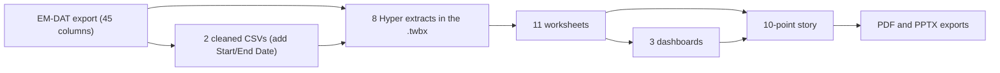

# A Century of Natural Disasters, 1900 to 2021

A Tableau data story on 122 years of EM-DAT disaster records. Ten story points move from global frequency trends to regional hotspots, human cost, aid versus damages, and a 20-year forecast.

[](LICENSE)

This case study asks how the frequency, type mix, and human and economic cost of natural disasters changed between 1900 and 2021, and how aid compares with damages. I cleaned an EM-DAT export, built 11 worksheets and 3 dashboards in Tableau 2023.3, and arranged them into a 10-point story using calculated fields, data blending, viz-in-tooltip, and Tableau's built-in forecasting. The story is finished. The repository holds the packaged workbook plus PDF and PowerPoint exports, so you can read it without installing Tableau.

## Workbook highlights

- Story points 2 and 3 use two stacked area charts on the same fixed 1899 to 2026 year axis. The first plots a `Before1970` calculated field (record counts through 1969, zero afterwards) on a count axis fixed at 0 to 550, the same range the full series fills on the next point. Moving to point 3 then reveals the post-1970 rise against an unchanged scale.
- A `WeightedImpact` calculated field combines deaths (weight 1.0), injured (0.8), affected (0.6), homeless (0.4), and total damages (0.2). It labels the pre-1970 chart and appears in the full time series tooltip.
- Choropleth maps of records per country zoom from North America (Canada, United States, Mexico) out to the whole world. The global map blends a second data source for ISO country labels and embeds a viz-in-tooltip (`PieToolTip_Impact`) with deaths, injured, and homeless for the hovered country.
- Tableau's built-in forecasting projects yearly record counts and total damages 20 years ahead (2021 to 2040) with 95% prediction bands, on the `ForecastedNaturalDisasters` and `TotalDamages` sheets. The forecast options are set to ignore the last data year.
- A Top 10 filter keeps the most frequent disaster types in the bar chart, and a `Monochrome Disaster` color field highlights floods and storms in the bubble chart while greying out the rest.

## What the story shows

These readings come from `Natural_Disasters_1900_2021.pdf`. Counts are raw EM-DAT records, not adjusted for changes in reporting coverage. Values marked "about" are read off chart axes.

| Finding | Value | Source |
|---|---|---|
| Recorded deaths, 1900 to 2021 | 32,445.62K (about 32.4 million) | `PieToolTip_Impact` sheet, PDF p. 20 |
| Recorded injured | 10,209K (about 10.2 million) | same sheet |
| Recorded homeless | 178,102K (about 178.1 million) | same sheet |
| Records per year | Under 100 in every year before 1970; peaks above 500 in the early 2000s | Story points 2 and 3, PDF pp. 2 to 3 |
| Most frequent types | Flood (about 5,500 records), then Storm (about 4,500); Earthquake and Epidemic near 1,500 each | Top 10 bar chart, PDF p. 4 |
| Countries with the most records | United States, China, and India carry the darkest shading | Global map, PDF p. 6 |
| Damages and aid | Storms have the largest total damages bar; floods take most of the plotted aid contribution (pie labels 79,946,298 for Flood, 2,248,530 for Other) | Response dashboard, PDF p. 8 |

## How the story is built

The workbook connects to a CSV of the raw EM-DAT export (45 columns) and two cleaned CSVs. The cleaned files drop Seq, Glide, Disaster Subsubtype, and the admin code columns, and add `Start Date` and `End Date`. One of them also drops ISO; the global map's blended ISO labels come from the other. All sources ship as 8 Hyper extracts inside the `.twbx`.



The ten story points, with captions as saved in the workbook:

| # | Story point caption | Sheet or dashboard |
|---|---|---|
| 1 | Introduction | `Title` dashboard |
| 2 | Did you know? The frequency and impact of natural disasters have increased significantly... | `disaster types over time (before1970)` |
| 3 | ...over the last half-century | `disaster types over time` |
| 4 | While all natural disasters can be devastating, certain types of disasters are more common and severe | `natural disaster frequency` (Top 10 bar chart) |
| 5 | Some regions are more prone to disasters than others | `Disasters (NorthAmerica)` map |
| 6 | Zoom out to Global View | `Disasters by Country Map` |
| 7 | Every disaster is unique, but some stand out for their devastating impacts | `BubbleChart_Disasters by Country` |
| 8 | The effectiveness of disaster response can vary greatly | `DisasterResponse` dashboard (aid pie, damages vs aid bars) |
| 9 | By learning from historical patterns and past events, we can improve our response to natural disasters | `NatDisasters` dashboard (two forecasts) |
| 10 | Citations | Empty in the saved workbook |

## Tech stack

Tableau 2023.3 (story points, calculated fields, data blending, viz-in-tooltip, built-in forecasting), Tableau Hyper extracts, Mapbox and OpenStreetMap basemaps. The PDF and PPTX were exported from Tableau.

## Opening the workbook

You need Tableau Desktop or the Tableau Public desktop app, version 2023.3 or later (the workbook was saved with Tableau 2023.3). Without Tableau, the PDF and PPTX show every story point as a static page.

```bash
git clone https://github.com/TirtheshJani/Case_Study_Natural_Disasters_1900_2021.git
cd Case_Study_Natural_Disasters_1900_2021
```

Open `Natural_Disasters_1900_2021.twbx` in Tableau and select the "A Century of Natural Disasters" story tab. The data ships as extracts inside the file, so no database or CSV connection is needed.

A `.twbx` file is a zip archive. To inspect it without Tableau:

```bash
unzip -l Natural_Disasters_1900_2021.twbx
```

This lists the workbook XML (`Natural_Disasters_1900_2021.twb`) and the eight `.hyper` extracts.

## Repository layout

```text
.
├── Natural_Disasters_1900_2021.twbx   # packaged Tableau workbook (workbook XML + 8 Hyper extracts)
├── Natural_Disasters_1900_2021.pdf    # 30-page export: story points (pp. 1 to 10), then each sheet and dashboard
├── Natural_Disasters_1900_2021.pptx   # 11 slides: title slide plus one image per story point
├── LICENSE                            # MIT
└── README.md
```

## Status and next steps

The case study is complete as a static Tableau story; the workbook and exports were uploaded in January 2024. There is no code, test suite, or CI, because the deliverables are the workbook and its exports.

Known gaps and possible extensions:

- The Citations story point is blank in the saved workbook (PDF p. 10).
- The steps that produced the cleaned CSVs are not in the repository. The cleaned data exists only inside the packaged extracts.
- Yearly counts are not normalized for reporting coverage, so part of the post-1970 rise may reflect better recording rather than more events.
- `WeightedImpact` adds people counts and damages (in thousands of US$) in one sum with hand-set weights. A normalized version would make the score easier to compare.
- The forecasts have no holdout evaluation.
- Four calculated fields (`Duration`, `Disaster Flag`, `OFDAint`, and `Aid, Declarations, and Appeals.`) are defined but not yet on any sheet. The OFDA response and appeal fields could extend the response analysis.

## Data source

Disaster records come from [EM-DAT](https://www.emdat.be/), the international disaster database run by the Centre for Research on the Epidemiology of Disasters (CRED) at UCLouvain. The workbook's data sources are named `1900_2021_DISASTERS.xlsx - emdat data`. EM-DAT records remain subject to EM-DAT's terms of use. Map backgrounds are credited on the map sheets as © Mapbox © OpenStreetMap.

## Author

Tirthesh Jani · [GitHub](https://github.com/TirtheshJani) · [LinkedIn](https://www.linkedin.com/in/tirthesh-jani)

## License

Released under the MIT License. See [LICENSE](LICENSE).
